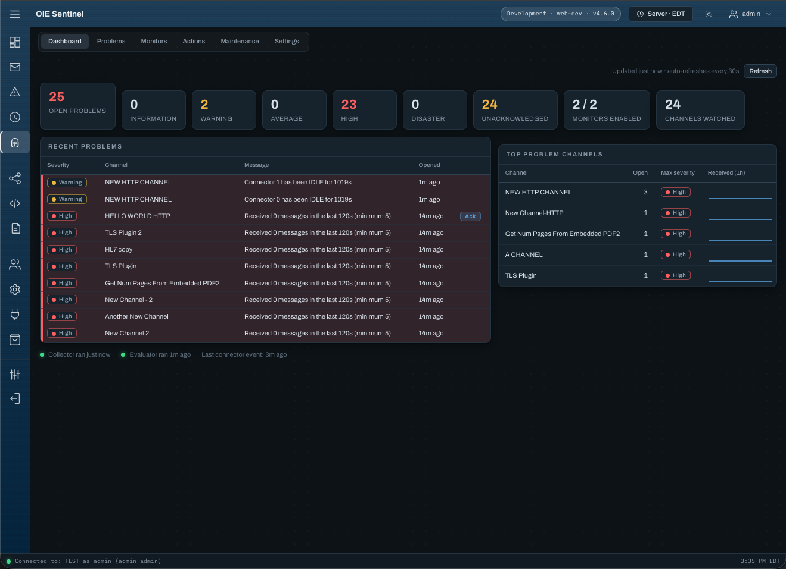
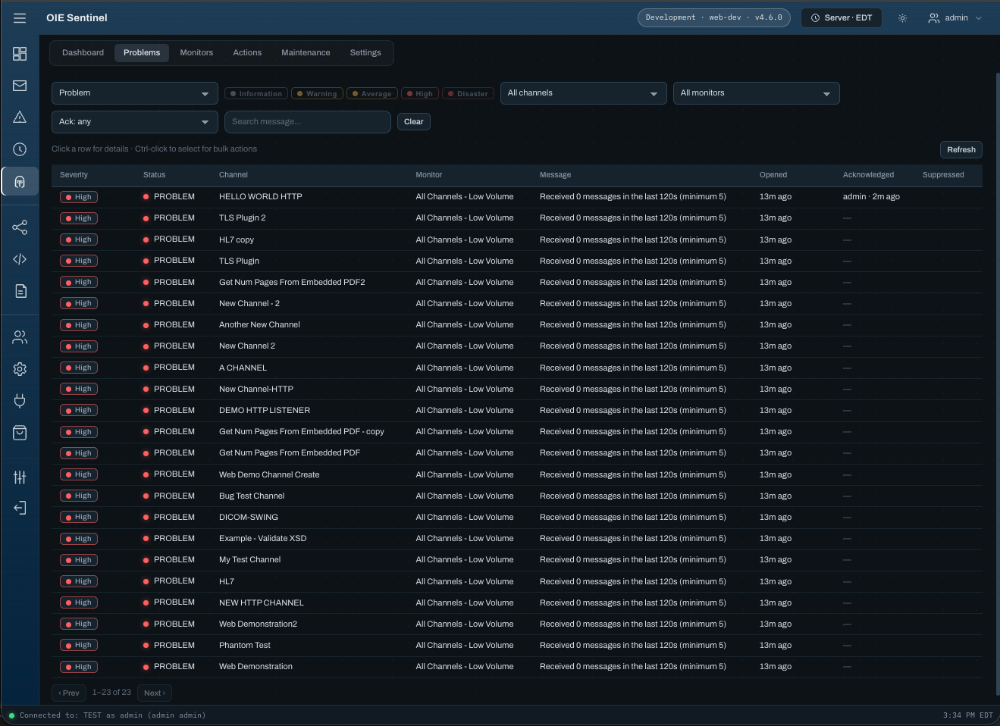
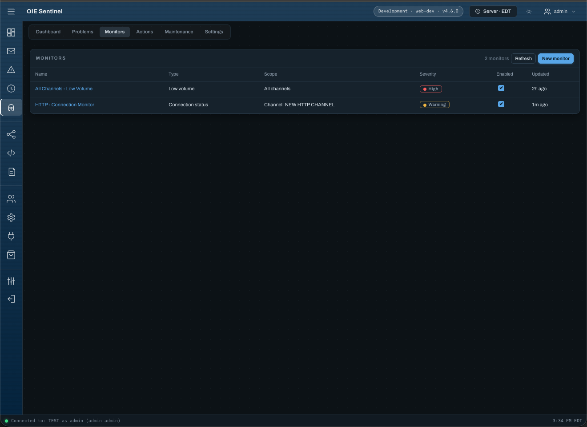
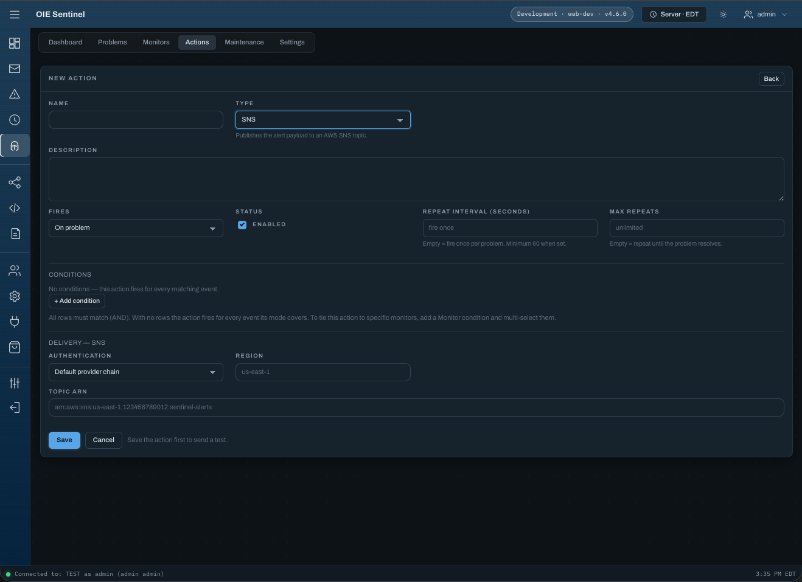
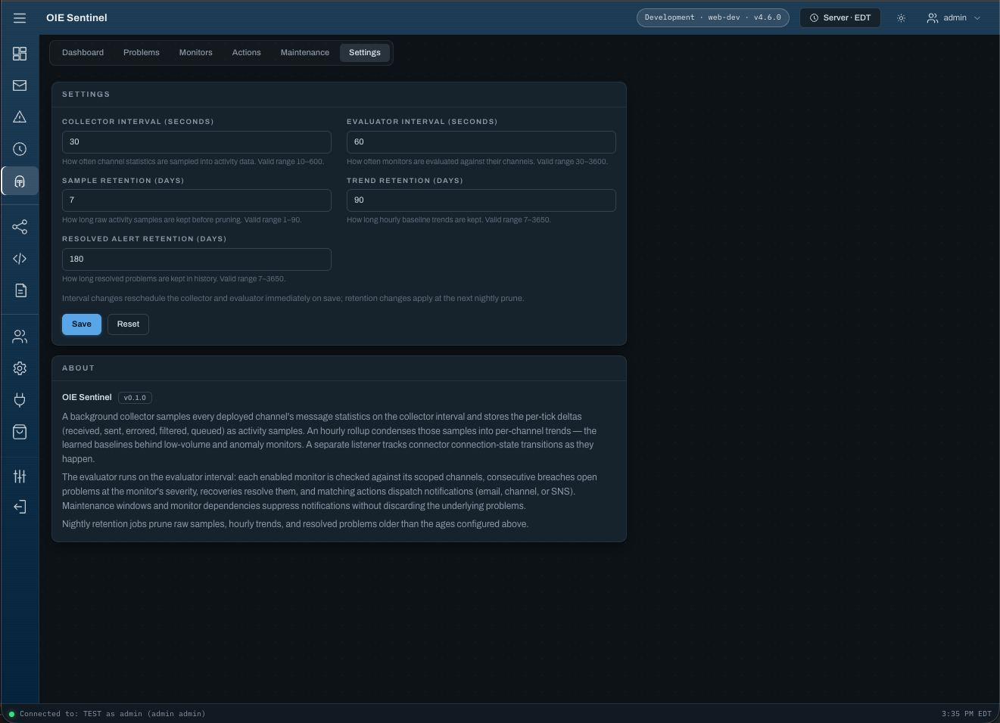

# OIE Sentinel

Release 1.2.2 is being prepared with engine compatibility limited to OIE **4.6.0 and 4.7.0**. Runtime validation on the final 4.7.0 release is pending; see the [release preparation notes](docs/oie-4.6-4.7-release.md).

Zabbix-inspired monitoring and alerting for [Open Integration Engine](https://openintegrationengine.org)
channel activity — inactivity, low-volume, anomaly, connection-status, error-rate and queue-depth
monitors, with email, channel (VM Router), AWS SNS and webhook alert delivery, storm control and
escalation, and a dashboard embedded directly in the OIE Web Administrator.

No Swing desktop client, and no standalone web app either — the UI is built entirely against the
`oie-web-client` plugin contract (`@oie/web-api`/`web-ui`/`web-shell`) and loads inside the main
console, riding its existing session (no separate login).



## Features

**Monitors**
- Seven monitor types: **Inactivity** (no messages for N minutes), **Low volume** (fewer than N
  messages per window), **Anomaly** (volume deviates from a rolling baseline), **Connection
  status** (connector state matching), **Error rate** (errored share of received messages over a
  window, with a minimum-volume guard so one error on a quiet channel is not 100%), **Queue
  depth** (destination queue at or above a threshold for a sustained period), and **Channel
  state** (see below).
- One more type, **Log lines**, makes a **Log** monitor: it watches the lines the engine logs,
  matched by level, logger name and pattern, and raises a notification or a problem (see below).
- Connection-status monitors roll up per connector or once per channel, so one channel losing its
  upstream pages once instead of once per destination.
- Channel monitors are scoped to a single channel, a channel group, a **channel tag**, or all
  channels — group and tag membership resolve live, so reorganizing channels never requires
  touching monitors.
- Per-monitor severity (Information → Disaster), minimum consecutive breaches, and dependency
  suppression (a parent monitor's open problem silences its dependents on the same channel).

### Channel state and connector monitoring follow deployment state

Activity monitors evaluate channels in `STARTED`: a stopped channel's source is not polling,
so an inactivity or volume breach against it
would be measuring the operator's own decision. The consequence is that stopping a production
channel raises no alarm; it *silences* the alarms that channel already had, which the evaluator
closes with "Channel is no longer started".

A **Connection status** monitor evaluates deployed connectors, including paused channels and
channels deployed only on another live cluster node. Missing observations remain insufficient data
until the deployment inventory and connector state can be established.

A **Channel state** monitor watches the state itself, so it is resolved against every channel in
scope whatever state it is in. It defaults to the resting states — `STOPPED`, `PAUSED`,
`UNDEPLOYED` — the ones a channel does not leave on its own. The transitional states (`STARTING`,
`DEPLOYING`, `STOPPING`, …) are selectable but never seeded: every ordinary redeploy passes through
them, and a default that paged on that would teach operators to ignore the monitor. Select one
deliberately, with a minimum duration long enough to clear a normal deployment, to catch a channel
stuck mid-start.

How long the state has held is read from the trigger row rather than from memory, so it survives a
plugin restart — "stopped since before the last restart" is the likeliest shape of the incident
this type exists to catch. The stamp is a lower bound: a monitor created while a channel is already
stopped counts from its own first tick, so it breaches one minimum-duration later rather than
immediately.

### Log monitors watch the engine log

The monitor editor asks for the kind first: **Channel** for the seven channel types above, or
**Log** for the Log lines type. A Log monitor fires on each matching line, on at least N matching
lines within a window (too many), or on at most N within a window (too few, such as a missing
heartbeat). Actions send its notifications and problems alike.

A notification is a one-off entry in the **Notifications** tab. It can't be acknowledged or
resolved. With each occurrence as the condition, every matching line gets its own notification, up
to 100 per monitor on each node in each collector interval, and one summary notification covers the
rest. A problem stays open in the Problems tab until the condition goes away, a person resolves it,
or the **Clear after** time set in the editor has passed since the condition was last true. Lines
that match while it is open are added to it.

For example, a heartbeat monitor opens a problem when no line matching `HEARTBEAT` arrives in 10
minutes (at most 0) and clears when one does. A deploy monitor sends a notification for each line
matching `deployed`.

A line matches when its level (TRACE, DEBUG, INFO, WARN, ERROR or FATAL) is at or above the
monitor's minimum level, its logger name starts with the logger prefix (if one is set), and the
pattern (a Java regular expression, if one is set) is found in the message or in the exception's
one-line summary (its class and message). A pattern sees the first 4,096 characters of each. A
mirth.log line shows its logger name just before the message, as in `[thread] js-connector: DB
access failed`. Channel scripts log under logger names such as `transformer`, `filter`, `deploy`,
`db-connector` and `js-connector`, so a transformer that catches a failed query and calls
`logger.error(...)` can be watched.

On each node, Sentinel adds a Log4j appender, a hook that receives every line the engine logs (log
capture, on the Dashboard). It copies each line that passes some Log monitor's level and logger
checks into a queue and returns. One Sentinel thread per node, the matcher, runs the patterns. Each
line's pattern checks stop after 20 ms in total and count as no match. The queue has room for 1,000
lines by default (**Log queue capacity** in Settings, 100 to 10,000). When it is full, new lines are
dropped and counted. For the node serving the page, the Dashboard shows how full the queue is, how
many lines were dropped, and whether log capture is counting. When it isn't, the Dashboard says why.
Prometheus has the same numbers as `sentinel_log_*`.

Every collector interval (set in Settings), each node writes one count row per Log monitor to
`sentinel_match_sample`, zero counts included. The leader (see [Clustered
deployments](#clustered-deployments)) adds up the rows from all nodes. A node marks a row incomplete
when lines may have gone uncounted: lines were dropped, a pattern check hit its time limit, log
capture was not attached, or the node restarted. An incomplete count can only be too low, so it can
still fire an "at least" monitor or clear an "at most" problem. It can't clear an "at least" problem
or fire an "at most" monitor. If the engine database can't be written, the counts wait in memory and
are written once it can.

Each count row also keeps how many lines matched in each second, so a window's edges are exact to
the second: a line logged before the window starts doesn't count, even when its count row was
written late. If the engine database can't be written for so long that one row's lines fall in
more than 3,600 different seconds, that row keeps only its line count, and a window that starts
within the period that row covers is incomplete.

A window is also incomplete until count rows cover all of it, from its start to now, with no gap
longer than two collector intervals. An incomplete window works as described above. So a monitor
that was just saved or enabled can't fire an "at most" condition until it has counted for a full
window.

The 20 ms limit is checked as the pattern reads characters, so a pattern that loops without reading
any can still stall the matcher on that node. After 5 seconds on one line the Dashboard shows log
capture as not counting, the queue fills, and new lines are dropped and counted.

A Log monitor watches no channel:
- Its problems and notifications show "Log" where a channel name would be, `${channelName}`
  included. They carry no channel id and add nothing to the Dashboard's channel badges.
- Only users with Manage Monitoring and no channel restrictions can create, change, enable, disable,
  delete or import Log monitors. Users with channel restrictions don't see Log monitors, their
  problems and notifications, or the log capture status on the Dashboard. Their exports leave Log
  monitors out, and they can't manage actions that can receive Log alerts (see
  [Permissions](#permissions)).
- Channel, channel group and channel tag action conditions never match them, whatever the operator.
  An action gets them through a **Monitor type** (Log lines) or **Monitor** condition, or by having
  no channel conditions. If such an action escalates, the action it escalates to gets the Log
  problems too.
- Schedules cover them only when scoped to all channels, and only another Log monitor can suppress
  one.
- A saved monitor can't change between Channel and Log.

A Log monitor does not count:
- Lines logged before Sentinel starts, such as engine startup and migration errors.
- Lines logged before the monitor's count starts. Each node starts it at its first collector run
  after the monitor is saved or enabled, up to one collector interval later.
- Lines logged on the threads Sentinel uses to deliver alerts, such as the error the engine logs
  when a Channel action routes to a channel that isn't deployed.
- Lines dropped because the queue was full.
- Lines the engine's log configuration drops: below a logger's level, or removed by the engine's own
  filter for mirth.log.

A Log monitor does count what a channel logs while it processes an alert that a Channel action
delivered to it. A monitor broad enough to match that channel's own errors therefore feeds itself:
each alert makes the channel log another line, which raises another alert. Narrow the monitor with
a logger prefix or a pattern, or give the action a **Storm control** ceiling.

With **Include matched items in alerts** on, a monitor keeps up to 10 of the newest matching lines,
each cut to 1,000 characters. They show in the Matches panel of the problem or notification, and
actions send them: in the email body, as `matches` in the webhook, SNS and Channel payloads (the
Channel action's source map key is `sentinelMatches`), and through the `${matches}` template token.
Sentinel stores them with the count rows in `sentinel_match_sample`, kept for the raw-sample
retention, and with the problem or notification, kept for the **Resolved alert retention**. Turning
the option off hides them in the UI and in what actions send, and the stored copies stay until
retention removes them. The option is off by default.

**Problems**
- Problem list with server-side filtering/paging, bulk acknowledge, and a detail pane with the
  captured value and dispatched-action log.
- A **Notifications** tab lists the notifications of Log monitors, newest first, filtered by
  monitor and date. Each opens to its matched lines and the actions it was sent to.
- Acknowledge and manual resolve, each confirmed in a single dialog with an optional comment;
  acknowledgments display the engine username.
- **Acknowledging stops repeat notifications** without resolving the problem — the alarm stays open
  so it cannot re-fire while the condition persists, and the resolve notification still goes out
  when it clears.

**Actions (alert delivery)**
- Email (engine SMTP), Channel (route the alert payload into an OIE channel via VM Router), AWS
  SNS, and Webhook (HTTPS POST to Slack, Teams, PagerDuty, Alertmanager…) senders.
- Webhook URLs, body templates, and all header values are encrypted when saved and masked in
  API responses and exports. Leave a masked value unchanged to retain it; replace it in full to
  change it. Existing plaintext fields remain deliverable and are encrypted the next time the
  action is saved. An import with unavailable masked secrets skips that action until the secrets
  are supplied, preserving the intended payload and authentication.
- Every transport call has the same 30-second hard wall-clock ceiling (a transport may use a
  shorter one); expiry cancels the call and releases the bounded dispatch worker.
- Open and resolution notifications use ordered durable outbox flags and reconcile missing
  per-action dispatch rows. A full dispatch queue, restart, short-lived incident, or partial fan-out
  therefore delays a one-shot edge instead of losing it. A crash between an external send and its
  dispatch-log commit can cause a duplicate on retry.
- **Storm control**: a per-action notification ceiling over a rolling window, past which individual
  sends are held and one rollup notification names the affected channels; plus flap detection, so a
  trigger bouncing between problem and OK notifies once and then goes quiet until it settles.
- **Escalation chains**: a problem still open after N seconds routes to a different action — a
  wider audience — with cycle and hop-count guards. Acknowledged problems never escalate.
- Condition-based routing: severity (including `>=` thresholds), monitor type, **specific
  monitors** (multi-select), channel, channel group, **channel tag**, and event type — rows are
  ANDed; an action with no conditions fires for everything its mode covers.
- Repeat notifications per action (`repeat interval` + optional `max repeats`), paced through the
  dispatch log so repeat state survives server restarts.
- Drag-and-drop template tokens (`${monitorName}`, `${channelName}`, `${severity}`, `${status}`,
  `${message}`, and `${matches}` for a Log monitor's matched lines) for the email subject
  template.

**Schedules** (the *Schedules* tab)
- **Suppress** schedules — classic maintenance windows: notification decisions made while the
  window is active stay silent. A problem still open when maintenance ends gets its first
  notification then.
- **Alerting schedule** windows: the inverse — alerts on covered channels notify *only inside* the
  window (business hours, on-call rotations). Problems that opened during quiet hours are checked
  on every tick and notify on window entry if they remain open.
- Suppression is checked on the dispatch worker for opens, repeats, escalations and resolutions,
  so schedule edits and parent-monitor recovery take effect before a queued transport call rather
  than being frozen into the alert's creation-time state.
- One-time, weekly (days of week), or monthly (days of month) recurrence with start/end times on a
  **per-window time zone** — pick the zone your on-call rotation lives in and the schedule keeps its
  length across daylight-saving changes there; leave it blank to follow the OIE server's own clock.
  End at or before start wraps past midnight (e.g. 22:00–06:00).
- "Activate now" re-times a one-time window mid-incident without editing it.

**Outside the Sentinel tab.** Sentinel adds a column to the Dashboard and entries to the command
palette — so an operator does not have to know Sentinel exists to see that a channel is alarming.
Both only read Sentinel state or navigate into the plugin; everything that changes a monitor, an
action or a schedule lives in Sentinel's own UI.

**A Sentinel column in the Dashboard's channel table.** One badge per channel, in three states:

| Badge | Meaning |
| --- | --- |
| A **count**, filled in the severity colour | Open problems. The number is how many are open, the colour is the highest severity among them — three Information problems and one Disaster are very different situations, and a count or a colour alone would render them identically. Click it to open that channel's problems. |
| A green **✓** outline | Monitored, nothing open. |
| A dashed grey **–** | No enabled monitor covers this channel. Sentinel has nothing to say about it. |

That last distinction is the point of the column. Reporting "no monitor is watching this" the same
way as "watched and healthy" would present the absence of a watcher as the absence of a problem,
which is the most misleading thing a monitoring column could do. Coverage is resolved exactly —
channel scope directly, group and tag scopes through membership, and one ALL-scoped monitor covering
everything — using the same rule the evaluator applies. If the coverage lookup fails, the badge
reports "still loading" and never falls back to "not watched".

Open problems are polled once for the whole table rather than once per row; coverage is re-read
every five minutes, since it only changes when somebody edits a monitor.

**Command palette** (⌘K / Ctrl+K, then `>`) entries:

| Entry | Section | Needs |
| --- | --- | --- |
| Sentinel: Dashboard | Monitor | View Monitoring |
| Sentinel: Open problems | Monitor | View Monitoring |
| Sentinel: Unacknowledged problems | Monitor | View Monitoring |
| Sentinel: Schedules | Monitor | View Monitoring |
| New Sentinel Monitor | Create | Manage Monitoring |

The first four open a Sentinel tab; the last opens a blank monitor editor and sits in the palette's
*Create* section with the host's own New Channel and New Alert. All register into the host's palette
rather than a Sentinel-specific one, so they sit alongside its built-in entries and are filtered
through the same permission check it applies to those.

**Operations**
- Dashboard tab with problem counts by severity, per-channel activity charts, and top channels.
- Per-monitor history: alert count and mean time-to-resolve over time.
- Optional **runbook URL** per monitor, shown on the problem and available as `${runbookUrl}` in
  every alert template.
- **Prometheus endpoint** at `/extensions/sentinel/metrics` — open problems by severity, per-channel
  throughput, and collector/evaluator heartbeat age, honouring channel restrictions. The
  `sentinel_log_*` series report each node's Log queue capacity and depth, dropped lines, and
  whether log capture and the matcher are running. Scrapes with channel restrictions don't get them.
- **Export / import** of monitors, actions and schedules as one JSON document, matched by name and
  reported entity by entity, so configuration is promotable dev → test → prod and
  version-controllable. Export preserves all monitors, including legacy names that differ only
  by surrounding spaces or case. Import skips ambiguous monitor names and dependent references;
  rename the colliding monitors before retrying. New monitor names are trimmed on save.
  A rejected monitor replacement also skips its dependent monitors and actions, including
  suppression chains through existing monitors; independent entries can still import.
  Format 3 marks unresolved action monitor IDs and skips those actions and their escalation
  dependents until the source conditions are repaired and exported again. Older Sentinel versions
  reject format 3. Formats 1 and 2 remain accepted with monitor references interpreted as names;
  re-export old documents if their source actions contain stale IDs.
- Five RBAC permissions published for authorization plugins (see [Permissions](#permissions)).
- Mutations audited through the engine's event log; alert history, trigger state, and activity
  samples persist across restarts with configurable retention.
- **Sizing the sample table:** rows per day is `channels × 86400 / interval`. At the 30-second
  collector default, 200 channels write 576,000 rows a day and stand at roughly 4 million rows
  under the 7-day raw-sample retention default — in the engine's operational database, alongside
  message data. Raise the collector interval or lower the sample retention to size it down. Each
  tick is written as a single batched insert regardless of channel count.
- **Log monitor counts** add `Log monitors × nodes × 86400 / interval` rows a day to
  `sentinel_match_sample`, pruned with the raw-sample retention: 5 Log monitors on one node at the
  30-second default write 14,400 rows a day. A row with matched lines carries up to 10 lines of
  1,000 characters.

### Activity retention has two independent tiers

Raw collector samples (`sampleRetentionDays`, default 7, max 90) are tick resolution — one row per
watched channel per collector interval — and are what the activity chart's **Raw** granularity
draws. The hourly rollup (`trendRetentionDays`, default 90, max 3650) is a separate tier, written
by the rollup job and pruned on its own schedule, and is what **Hourly** draws.

Neither tier's lifetime derives from the other. A year-long chart is available out of the box at
hourly resolution even though raw samples were pruned after a week, and raising
`sampleRetentionDays` does not lengthen trend history.

**Auto** picks raw for ranges up to 6 hours and hourly beyond that. That is a rule about *range
width*, not about what data still exists — raw samples cover the whole sample-retention window, so
to chart tick resolution across a three-day incident, select **Raw** explicitly.

Any series is capped at 2000 points: a wider range is folded into equal buckets server-side, and
the caption under the chart reports what was actually drawn (for example "hourly rollup, 1h5m
buckets") rather than what was requested.

**Long retention belongs to the hourly tier, not the raw one.** Raw samples are capped at 90 days
precisely because they are 120× denser: at a 30-second collector each channel writes 2,880 raw rows
a day but only 24 hourly ones. A year of history for 200 channels is about 1.75 million hourly rows
— trivial. The same year at raw resolution would be 210 million, which is why it isn't offered.

### Pruning

A nightly job at 03:30 (leadership-gated, so one node in a cluster) removes raw samples, hourly
buckets, resolved alerts and connector status transitions past their retention (connector status
events share the raw-sample retention). Open problems are never pruned regardless of age, and
dispatch history follows its alert out by cascade. Retention values are re-read on every run, so
a settings change takes effect that night with no restart.

Deletes run in bounded passes of 5,000 rows rather than one statement, each its own transaction.
This matters for one specific operation: **lowering** a retention setting. Dropping
`sampleRetentionDays` from 90 to 7 asks the next prune to remove 83 days at once — roughly 48
million rows for 200 channels — and as a single transaction that means a long table lock, a
transaction log sized for the whole delete, and on PostgreSQL enough dead tuples to need a manual
`VACUUM`. Chunking bounds all three, and an interrupted prune simply leaves the remainder for the
next night.

## Screenshots

| | |
| --- | --- |
|  |  |
|  |  |

## Requirements

- OIE engine **4.6.0** — the engine loads a plugin only on the exact versions listed in its
  descriptor, so each new engine release needs a Sentinel release that has been verified against
  it (see `plugin.supported.mc.versions` in `pom.xml`)
- [oie-web-client](https://github.com/gibson9583/oie-web-client) (OIE Web Administrator) to host
  the dashboard UI
- Server restart after install/upgrade

### Clustered deployments

Sentinel is safe to install on every node of a clustered engine. Background work — the collector,
evaluator, hourly rollup and retention prune — is gated on a database-backed leadership lease
(`sentinel_node_lease`), so exactly one node does it at a time while the others stand by. Without
that gate, two nodes sharing a database would each write a full set of activity samples, doubling
every message delta and corrupting every volume baseline, while both evaluators raced on the same
trigger rows.

The REST API and dashboard serve from **any** node, leader or not. Only scheduled work is
leadership-gated.

Connector transitions are node-qualified and every node maintains its own database-clock presence
lease, including standbys. Each heartbeat atomically publishes that node's deployed-channel
inventory with its presence lease. The leader evaluates connector state across the live nodes
that deploy the channel. A clean stop removes that node immediately, while an unclean loss removes it after the 90-second
presence lease expires. Historical rows are retained for diagnostics but a permanently retired
node cannot keep a connector problem open forever. Leadership epochs are checked inside database
transactions and immediately before notification transport starts. Pending notifications survive
queue saturation and failover. Configure a stable engine server id on every cluster member;
when the engine does not provide one, Sentinel derives a restart-stable fallback
from the hostname and that installation's application-data directory.

Failover is automatic. A clean shutdown hands the lease over within about 30 seconds; an abrupt
node loss takes up to about 2 minutes (a 90-second lease plus the next node's heartbeat). The new
leader's first collector tick records zero deltas rather than counting each channel's lifetime
total as one interval, so one tick of sampling is lost on failover by design. Leadership changes
are logged at INFO, naming the node — the first thing to check during an HA incident.

For a clustered upgrade to 1.2.1, stop Sentinel on every node before starting the updated plugin.
All nodes must use the new version before monitoring resumes; a rolling mixed-version upgrade
is not supported. Upgrades from 1.1.2 or earlier must also account for the encrypted webhook
values introduced in 1.2.0. See the [upgrade procedure](docs/releases/1.2.1.md#upgrading).

## Install

1. Download `sentinel-<version>.zip` from [Releases](https://github.com/gibson9583/oie-sentinel/releases)
   (or install from an OIE Community Store that lists this plugin).
2. Install via the Web Administrator (Settings → Extensions) or drop the zip into the engine's
   extension install flow, then restart the server.
3. On first start the migrator creates twelve `sentinel_*` tables in the engine database (Derby,
   PostgreSQL, MySQL, Oracle, and SQL Server DDL included); schema upgrades run automatically on
   later versions.

### Uninstalling deletes Sentinel data

Explicitly uninstalling Sentinel **drops all twelve of its database tables on the next engine
startup**, deleting monitors, actions, schedules, alert history, delivery records, and collected
activity. This applies to Derby, PostgreSQL, MySQL, Oracle, and SQL Server. No new archive tables
are created; Oracle also purges the dropped tables from its recycle bin. Reinstalling creates an
empty Sentinel schema. Back up the database first if you need to recover this data later.

**Upgrades preserve existing data:** install the new version over the existing extension and
restart. Normal upgrades run schema migrations without invoking uninstall SQL. Do not uninstall
as an upgrade or rollback step: an explicit uninstall followed by an install still deletes the
data, even when both operations are queued before the same restart.

For a cluster sharing one database, coordinate removal across all nodes: uninstalling Sentinel
on one node deletes the tables used by every node. Archived tables left by older versions are
not part of the live schema and are not removed by this uninstall script.

## Permissions

Sentinel publishes five extension permissions so RBAC-style authorization plugins can map real
operational roles:

| Permission | Grants |
| --- | --- |
| View Monitoring | Monitoring reads: dashboard, problems, authorized monitors, actions, windows, activity |
| Acknowledge Problems | Acknowledge, bulk acknowledge, manual resolve |
| Manage Schedules | Schedule create/update/delete and "activate now" (on-call tier) |
| Manage Monitoring | Monitor and action authoring, including delivery credentials and test sends |
| Manage Settings | Scheduler intervals, data retention and the Log queue capacity only |

Delivery credentials — SNS access keys and role ARNs — and recipient lists are part of an action's
configuration, so they belong to Manage Monitoring. Manage Settings covers only the five
scheduler-interval and retention values and the Log queue capacity on the Settings page.

Channel-restricted viewers see monitor definitions only when their complete, nonempty scope is
within the user's authorized channels, including stopped and undeployed members. This applies to
CHANNEL, GROUP, TAG and ALL scopes, suppression ancestors, monitor details and history, and dashboard
monitor totals. Mixed, empty, missing and unresolved scopes are hidden; hidden monitor IDs
return 404. Group and tag pickers use the same complete-membership rule. Scope membership and
permissions are checked for each request. Authorized channel events remain readable even if their
monitor's current definition is hidden or the channel has been deleted; problem details omit a
hidden definition's current name, type and runbook URL. Coverage includes authorized channels watched
by any enabled monitor, even when the definition itself is hidden. Restricted coverage responses
contain explicit authorized channel IDs and never identify global ALL-scope monitoring.

The full user-name directory additionally requires the engine's **Manage Users** permission. Without
it, the lookup returns only the caller and acknowledgement authors on their visible channels; the UI
uses user IDs for any remaining attribution. Action and schedule definitions remain
global configuration reads. **Manage Monitoring** grants global configuration authoring and export;
**Manage Schedules** grants global schedule authoring. These management grants are broader than a
channel-scoped monitoring view and should be assigned accordingly.

For users with channel restrictions, Manage Monitoring doesn't cover Log monitors or their alerts
(a Log monitor's problems and notifications). They can't create, change, enable, disable, delete or
import Log monitors, and their exports leave Log monitors out. They can't create, change (including
enabling or disabling), delete or import an action that can receive Log alerts. An action can
receive Log alerts if its conditions let a Log monitor through (an action with no conditions does),
or if another action that can receive Log alerts escalates to it. Restricted users can still manage
an action with a channel, channel group or channel tag condition, unless another action that can
receive Log alerts escalates to it.

Without an authorization plugin installed, the engine permits everything.

## Build

Requires **JDK 21+** (the 4.6.0 engine jars are Java 21 bytecode; the plugin itself targets
`--release 17`). On a fresh machine or wiped `~/.m2`, first install the 4.6.0 engine jars into the
local Maven repository (the public repsy mirror does not carry every engine version) — the engine
must be built first so its `setup/` output jars exist:

```bash
ENGINE_DIR=/path/to/engine ./scripts/install-engine-jars.sh
```

Then:

```bash
./build.sh          # or: mvn clean package
```

Output: `package/target/sentinel-<version>.zip` — the installable extension archive, including the
built `webadmin/` dashboard bundle. CI does the same, sourcing the engine jars from the published
OIE distribution tarball instead of a local checkout (see `.github/workflows/build.yaml`).

## Project structure

```
oie-sentinel/
├── shared/     JAX-RS interface (SentinelServletInterface) + DTOs
├── server/     ServicePlugin, migrator, repositories, collector/evaluator jobs, alert senders
├── package/    plugin.xml, per-vendor MyBatis mappers, assembly.xml
├── webadmin/   the entire dashboard UI (embedded plugin for the OIE Web Administrator)
└── build.sh    orchestrates mvn package (builds webadmin/ via frontend-maven-plugin) + zip
```

## Releasing

See the [1.2.1 release notes](docs/releases/1.2.1.md), including the cluster upgrade and rollback instructions.

```bash
git tag v1.2.1 && git push origin v1.2.1
```

The tag must match `oie.json`'s `version`. CI builds the bundle, stages a **draft** GitHub Release
with the zip and its `.sha256` sidecar; publishing the release (a human step) triggers the optional
catalog PR that files the version manifest to the community catalog configured via the
`CATALOG_REPO` Actions variable and `CATALOG_TOKEN` secret. Tags containing a hyphen (e.g.
`v0.2.0-rc1`) publish as pre-releases.

## Design

See [`docs/ARCHITECTURE.md`](docs/ARCHITECTURE.md) for the full schema, REST API,
collection/evaluation pipeline, and web-UI design this project was scaffolded from.

## License

[MPL-2.0](LICENSE)
